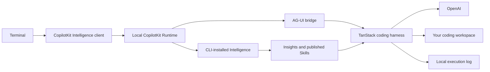

# TanStack AI + CopilotKit Intelligence

Run a TanStack coding agent with the CLI-installed local Intelligence backend.

**Status: in development.** Protocol, tool, approval, cancellation, and restart tests pass with a deterministic model. Real model execution and the full Learning cycle still need verification. See [the evidence record](docs/VERIFICATION.md).

## What runs where



TanStack owns the model loop, coding tools, and approvals. Intelligence owns durable product runs and Learning inputs. SQLite stores the harness state needed to resume a conversation after the app stops. It does not replace Intelligence.

The starter uses TanStack AI `1.0.0` and the experimental harness `0.1.0`. All direct dependencies have exact versions. Keep the lockfile.

## Prepare the app

You need Node.js 22.13 or later, pnpm 10.9, Docker, and an OpenAI key. The CLI also requires CopilotKit sign-in and local evaluation terms acceptance.

1. Open this repository.
2. Install the pinned dependencies:

   ```sh
   pnpm install --frozen-lockfile
   ```

3. Create your private configuration:

   ```sh
   cp .env.example .env
   ```

4. Set `OPENAI_API_KEY` in `.env`. Do not paste keys into chat or commit them.
5. Create the sample workspace:

   ```sh
   pnpm workspace:create
   ```

The workspace command refuses to replace an existing folder. This checkout already has the sample workspace.

## Install local Intelligence

Start Docker first. The CLI checks available CPU, memory, and storage.

1. Sign in:

   ```sh
   pnpm intelligence login
   ```

2. Review and accept the local evaluation terms yourself:

   ```sh
   pnpm intelligence local accept-terms
   ```

3. Install the backend:

   ```sh
   pnpm intelligence local setup
   ```

   Choose an OpenAI model for Learning and enter its key in the masked prompt. Do not defer model configuration for the full Learning walkthrough.

4. Review the connection changes:

   ```sh
   pnpm intelligence local connect
   ```

5. Apply the connection:

   ```sh
   pnpm intelligence local connect --approve-connection
   ```

The CLI writes `INTELLIGENCE_API_URL`, `INTELLIGENCE_GATEWAY_WS_URL`, and `CPK_INTELLIGENCE_API_KEY`. The starter reads these exact names. It refuses a remote backend URL.

If the CLI reports `authentication_required`, finish sign-in before you retry. If it reports `release_unavailable`, inspect the failed download before starting another installer.

On this machine, Docker Desktop's credential helper blocked the public Helm download. The working diagnostic used an empty temporary Docker configuration and the existing Docker socket. It changed no saved Docker settings. See [the evidence record](docs/VERIFICATION.md) before using that workaround.

## Create the Learning Container

After the CLI connects this project, create its container:

```sh
pnpm intelligence learning containers create --id coding-lessons --name "Coding lessons" --json
```

`LEARNING_CONTAINER_ID` defaults to `coding-lessons`. Use one stable container for this project. Each new Intelligence thread receives that assignment through `getLearningContainerId`.

The command above is the published CLI interface. Its use against the local stack remains part of the pending acceptance test.

## Run a coding task

Start an interactive session:

```sh
pnpm dev
```

Enter this task:

```text
Update greet so it trims names and rejects blank names with a clear error.
Add tests before changing the function. Run npm test and report the result.
```

The agent uses the official workspace tools. File changes and shell commands can ask for approval. Read the displayed call before answering `y`.

The workspace root limits file tools. A shell command can access the host, so it is not a sandbox. Use this starter with a trusted local workspace.

The terminal prints a thread ID. To reopen that thread:

```sh
pnpm dev --thread <thread-id>
```

For a single task:

```sh
pnpm dev --prompt "Read the project and explain the existing test."
```

A task that needs approval requires a terminal. A piped task exits with a resume command instead of approving a tool call.

Enter `/exit` to close the app. The CLI-installed backend remains running. Use `pnpm intelligence local stop` to stop it without deleting data.

## Complete the Learning cycle

A configured Learning model is not proof of Learning. The current backend needs at least 15 distinct conversations for the first Learning run. One conversation with 15 messages does not satisfy that requirement.

1. Run real coding tasks in separate threads. Give specific feedback about incorrect code, test gaps, and useful conventions.
2. Open the local dashboard URL from `pnpm intelligence local status`. Inspect the saved tool calls and results.
3. Open the container's Learning view. Start the available Learning action after its eligibility gate passes.
4. Inspect the resulting Insights and proposed Skills. Approve only a Skill supported by the recorded work.
5. Start a new coding task. Check that `list_learned_skills` and `load_learned_skill` return and use the published Skill.

The starter reads published Skills through the pinned Intelligence Skill registry. It checks archive integrity and exposes two TanStack tools. The model receives a catalog first, then loads a specific Skill.

Useful CLI reads:

```sh
pnpm intelligence learning insights list coding-lessons
pnpm intelligence learning candidates list coding-lessons
pnpm intelligence learning skills list coding-lessons --full
```

The complete real Learning run, candidate review, and later Skill use are still pending. Do not treat this walkthrough as a recorded successful run.

## Change the starter

| File | Responsibility |
| --- | --- |
| `src/harness.ts` | Model, official coding plugins, prompts, and learned-Skill tools |
| `src/bridge.ts` | Harness-to-Intelligence event ordering, run IDs, cancellation, and cloning |
| `src/app.ts` | Local runtime, server authentication, Learning assignment, and shutdown |
| `src/cli.ts` | Terminal prompts, streaming output, and approvals |
| `src/log-store.ts` | SQLite implementation of TanStack's execution-log contract |

Set `CODING_WORKSPACE` to a trusted project folder. The default is `workspace/`. Keep `.data/` with this starter: it holds the harness execution log.

Change the model in `src/harness.ts`, or pass a TanStack text adapter to `createCodingHarness`. The initial model is `gpt-4.1`. The Learning model has separate configuration in the CLI-installed stack.

The runtime binds only to loopback and uses a random bearer token for each app process. The terminal sends that token. The local user ID is `local-developer`; this starter is for one developer.

The Skill registry uses the SDK's `internal/learned-skills` export. This is an explicit version-sensitive boundary. Run the tests before upgrading CopilotKit.

## Check changes

```sh
pnpm check
node --test example/greet.test.js
```

`pnpm check` runs lint, TypeScript, tests, and build. The persistence suite runs TanStack's own contract checks. It skips stores this starter does not implement; only its execution log uses SQLite.

## Official references

- [TanStack harness CLI example](https://github.com/TanStack/ai/tree/5651e07e3181745984155ad88b65b86b8528844e/examples/harness-cli)
- [Build your first harness](https://tanstack.com/ai/latest/docs/harness/overview)
- [Coding tools](https://tanstack.com/ai/latest/docs/harness/coding-tools)
- [Session log](https://tanstack.com/ai/latest/docs/harness/session-log)
- [CopilotKit CLI](https://www.npmjs.com/package/copilotkit)

The [plan and review log](docs/PLAN.md) records the next review cycle.
