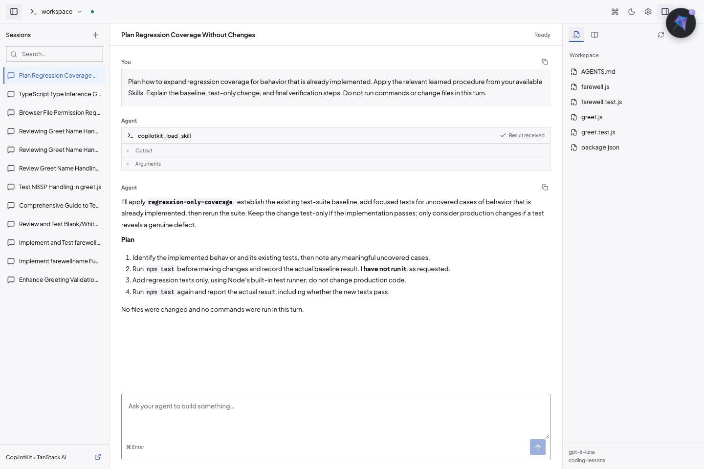

# TanStack Coding Starter

Build your own browser-based coding agent with **TanStack AI**, **CopilotKit React v2**, and **CopilotKit Intelligence**.

Start with a working local workspace: ask the agent to inspect files, review its proposed commands and patches, and approve each action. Conversations persist in Intelligence. Reviewed lessons become reusable Skills that the agent receives on its next turn.



This checkout pins SDK and CLI development previews. Archive checksums are recorded in
`docs/alpha-artifacts/` and `pnpm-lock.yaml`. After changing preview URLs and verifying
their archive records, run `node scripts/pin-alpha-integrity.mjs` and a frozen install.

An existing CLI-managed stack keeps its installed backend release. Updating dependencies
does not upgrade that stack. Check `pnpm intelligence local status --json` before selecting
an upgrade or another stack. Preserve existing conversations and Skills when changing connections.

## What you get

| Part                                | What it does                                                           |
| ----------------------------------- | ---------------------------------------------------------------------- |
| TanStack AI harness                 | Runs your selected model, workspace tools, and permission pauses       |
| CopilotKit React v2                 | Streams the conversation, restores sessions, and renders approvals     |
| Intelligence                        | Stores conversations and turns their evidence into Insights and Skills |
| TanStack Router, Query, and Virtual | Manage URL selections, server reads, and long transcripts              |
| Hono                                | Routes and validates local APIs; mounts the CopilotKit v2 adapter      |
| Vite, tsdown, Oxlint, and Oxfmt     | Build, check, and format the browser and Node service                  |

This is a starter for one trusted local developer. Provider keys stay on the server. An approved shell command can access your host; the workspace is not a sandbox.

## Get running

You need Node.js **22.13+**, pnpm **10.9**, Git, Docker, and access to your chosen model provider or local model server. Start Docker before setting up Intelligence.

### 1. Prepare the starter

```sh
pnpm install --frozen-lockfile
cp .env.example .env
cp models.example.json models.json
cp learning.example.json learning.json
pnpm workspace:create
```

Configure your coding models in `models.json` and their referenced keys in `.env`. Keep both files private.
Choose your own providers and model IDs. [Model configuration](docs/MODELS.md) covers native adapters, compatible endpoints, and multiple choices.
For guided setup, ask your coding assistant to use the repository `$setup` skill. `workspace:create` copies the small greeting example into `workspace/` and refuses to replace an existing folder.

### 2. Sign in to CopilotKit

```sh
pnpm intelligence login --json
pnpm intelligence local accept-terms
```

Review and accept the evaluation terms yourself. An agent cannot accept them for you.

### 3. Install Intelligence and configure Learning

Configure Learning separately in `learning.json`. It can use the same provider as coding or a different one.
The [Learning configuration guide](docs/MODELS.md#learning-configuration) explains native and compatible endpoints.

```sh
pnpm learning:config
pnpm intelligence local setup --model-config .data/learning-model.json --json
```

The CLI validates its supported model catalog and the current agreement. Provider keys stay in private configuration.
Existing stacks retain their installed release. Do not change backend images as part of normal startup.
[Temporary release diagnostics](docs/TEMPORARY-INTELLIGENCE.md) apply only to the older release described there.

### 4. Connect this app

```sh
pnpm intelligence local connect
pnpm intelligence local connect --approve-connection
pnpm intelligence learning containers create --id coding-lessons --name "Coding lessons" --json
```

Review the connection before approving it. The CLI writes `INTELLIGENCE_API_URL`, `INTELLIGENCE_GATEWAY_WS_URL`, and `CPK_INTELLIGENCE_API_KEY` to the app configuration. If `coding-lessons` already exists, keep that container.

### 5. Open the browser

```sh
pnpm dev
```

Open **http://127.0.0.1:4173**. Try this task:

```text
Inspect greet.js and its tests. Add coverage for blank and padded names.
Run the tests before changing behavior. Explain any proposed changes,
then run the tests again and report the actual result.
```

## Work with the agent

Choose **Model: [name]** in the composer to select a configured model for this conversation.
The choice survives reloads and server restarts. New conversations use the workspace default selected in **Settings → Models**, initially your configured default.
Coding and goal checks use this selection; Intelligence Learning keeps its separate configuration.

Review each approval card before choosing **Allow once** or **Reject**. Consecutive completed tools share a compact activity summary. Expand it to see individual calls, then open a call for its exact evidence. Failed, denied, running, and missing-result calls remain visible outside completed groups. Bash previews show the exact command; patch previews show added and removed lines.
Use the copy controls for exact payloads and **Raw details** for original arguments. Completed calls start collapsed. Your expansion choices last while the conversation stays open, including when you scroll through a long history. Execute TypeScript calls show submitted source and output together when expanded. Copy actions retain exact source and response text; structured output is indented for reading. Approval applies only to that tool call. If submitting a decision fails, retry it from the same card.

Choose **Create goal**, enter an objective, then choose **Start goal**. **Cancel** returns to your unchanged message draft.
Goal mode continues for up to 20 rounds, with an additional model check after each round.
It pauses for approvals or failures. Resolve the approval, then choose **View goal** and **Resume goal**.
**Stop goal** stops continuation and cancels active work. The objective and its state survive reload.
Completion is the agent's assessment; inspect its evidence. [Goal behavior and design](docs/GOALS.md).

Use the stop control to cancel a run. Click a session name to reopen its conversation; browser Back and Forward restore your selection. The transcript follows new output while you are at the bottom. Scroll up to read without being pulled down, then use **Jump to latest** when ready.

The workspace picker opens existing folders or creates named workspaces. Switch, rename, or remove entries there. Removing an entry keeps its files and conversations; opening the same folder restores its identity. Files and sessions stay scoped to the selected workspace.

The right panel previews files and published Skills. Folders start collapsed and load on expansion. Directory pages contain up to 100 entries, with a control to load more. Search runs across workspace file paths, including unopened folders. Search results also load in pages; neither browsing nor search stops at 1,000 files. Folders sort before files. Git colors and status badges show file changes and aggregate folder changes. Search file paths, open a file, and expand the viewer for more reading space. Code supports syntax highlighting, find, line navigation, wrap, copy, and download. Markdown and HTML have Source and Preview modes. HTML runs unchanged in an isolated iframe; scripts work, while parent access, popups, forms, and top navigation stay blocked. Network requests remain possible. Images support fit, zoom, and rotation; PDFs support page navigation and extracted page text. DOCX, XLSX, and PPTX have local reading previews with an original-file download. Legacy Office formats download without a preview. Office layout and advanced formatting can differ; workbook formulas show saved values.

Text previews are limited to 256 KiB; assets and downloads to 20 MiB. Use the header controls for panels and settings.
Settings uses a left-side menu for **Appearance**, **Models**, and **Permissions**.
In **Settings → Appearance**, choose **Light**, **Dark**, or **System**. System follows your operating-system appearance. Keep one of eight warm accents, or choose **Add color** to enter HEX, RGBA, HSV, or CMYK values. Custom swatches and appearance persist in this browser. CMYK is an approximate screen conversion. Interface shades adapt for readable contrast. Press **⌘K** or **Ctrl+K** for the command menu. CopilotKit's Inspector is enabled in local development. Motion respects your system's reduced-motion setting.

## Teach it a reusable lesson

1. Complete tasks in separate sessions and give specific feedback about useful conventions or mistakes.
2. Run `pnpm intelligence local login` to open the local dashboard.
3. Open `coding-lessons`, start a manual Learning run, and inspect its status and evidence.
4. Review a proposed Skill and approve it when the evidence supports it.
5. Start another relevant task in the browser. The agent receives the updated catalog automatically and can load the Skill without a restart.

The catalog is refreshed through the SDK before each turn. Skills are not copied into the starter's source tree. Repository development skills under `.agents/skills/` are separate: they guide the assistant changing this template.

## Find your way around

The application source is under `src/`:

- `client/`: React workspace, components, navigation and file viewers.
- `server/http/`: Hono API routes, validation and local access checks.
- `server/agent/`: coding harness, model adapters, permissions and Learning.
- `server/workspaces/`: workspace registry, file access and discovery.
- `server/storage/`: private SQLite execution and metadata adapters.
- `shared/`: browser-safe API types.

`server/main.ts` starts the process; `server/app.ts` connects services and owns their
lifetime. Use the [backend design](docs/BACKEND-DESIGN.md) and [API reference](docs/API.md)
when adding endpoints. The repository `$starter-api` skill encodes those conventions.

## Make it your own

| Change                                   | Start here                                                                                               |
| ---------------------------------------- | -------------------------------------------------------------------------------------------------------- |
| Model or model options                   | [`models.json` configuration](docs/MODELS.md)                                                            |
| Tools, prompts, or permission policy     | [`src/server/agent/harness.ts`](src/server/agent/harness.ts)                                             |
| Transcript, approvals, and tool displays | [`src/client/components/`](src/client/components/)                                                       |
| Workspace shell and navigation           | [`src/client/workspace.tsx`](src/client/workspace.tsx), [`src/client/router.tsx`](src/client/router.tsx) |
| Learning catalog integration             | [`src/server/agent/learned-skills.ts`](src/server/agent/learned-skills.ts)                               |

Read [AGENTS.md](AGENTS.md) and [architecture](docs/ARCHITECTURE.md) before changing ownership boundaries. Keep CopilotKit React imports on `/v2`: CopilotKit owns messages, Router owns URL selections, and Query owns server reads. [Agent guidance sources](docs/AGENT-SKILLS.md) explains the installed TanStack and React skills.

## Design with Impeccable

The template includes Impeccable 4.7.0 for design reviews, typography, layout, accessibility, and browser iteration.
Ask your coding assistant to use `$impeccable audit` or `$impeccable polish` on the UI you are changing.
`PRODUCT.md` and `DESIGN.md` keep those changes aligned with this starter's compact developer workspace.

Run `pnpm design:check` for source checks and `pnpm design:browser` for rendered tool and approval checks.
The source check also runs inside `pnpm check`. [Impeccable setup and investigation](docs/IMPECCABLE.md) covers hooks, live mode, and upgrades.

## Check and build

```sh
pnpm check
pnpm format:check
node --test example/greet.test.js
pnpm test:e2e
```

Start the app before browser tests. `pnpm check` runs lint, the design source check, both TypeScript checks, unit tests, and production builds. Live model tests are opt-in because they use your configured provider account; see [verification](docs/VERIFICATION.md) for their prerequisites and commands.

```sh
pnpm build
pnpm start
```

Stop the app with Ctrl-C. The backend remains available until you run `pnpm intelligence local stop`, which preserves its data. Keep `.data/` across restarts: it holds workspace identities and local execution logs. `CODING_WORKSPACE` selects the initial folder (default `workspace/`); `LEARNING_CONTAINER_ID` selects the Learning container (default `coding-lessons`).

## If something does not work

| Symptom                          | Check                                                                                                                                           |
| -------------------------------- | ----------------------------------------------------------------------------------------------------------------------------------------------- |
| Runtime unavailable              | Docker is running; run `pnpm intelligence local status` and check the CLI-written connection settings                                           |
| Model request fails              | The selected model ID, endpoint, and referenced key match your provider configuration                                                           |
| No learned Skills                | The configured container has an approved Skill; a pending candidate is not published                                                            |
| Need to undo the temporary image | Run `pnpm intelligence:image:restore` and follow the [retirement checklist](docs/TEMPORARY-INTELLIGENCE.md#retire-the-workaround-after-release) |

The app accepts only local Intelligence URLs. Private dot paths and outside symlinks are excluded from file previews and downloads. Large frontend chunks remain a build warning. For the exact checks, real Learning runs, screenshots, and limits, read the [latest UI proof](docs/NEW-IMPROVEMENTS-VERIFICATION.md) and [runtime verification record](docs/VERIFICATION.md).

## Permissions and planning

The composer has two permission choices:

- **Require permissions** allows ordinary file edits. Commands and sensitive paths ask unless a saved rule allows them.
- **YOLO** bypasses approval requests and permission-rule denials. Separate tool restrictions still apply.

**Plan mode** is a separate toggle beside Create goal. It permits inspection but prevents edits and shell commands.
The permission preference stays selected during planning. Turning Plan mode off restores that preference.
Both choices belong to the selected thread and survive reloads. One thread can use YOLO while another uses Plan mode and a third requires permissions.
New threads start with Plan off and your workspace’s **Default permissions** choice in **Settings → Permissions** (initially Require permissions). **Default model** selects their coding model. These defaults persist across server restarts and do not change existing conversations. Changes apply to the next turn. Pending approvals still require a decision.

Interrupts offer **Reject**, **Approve Once**, and **Always Approve**. Both approval buttons use the positive action style.
Always Approve shows the exact scope before **Approve and Save** submits it. Saved permissions apply across conversations in the workspace.

**Settings → Permissions** lists saved rules with remove controls. Removal takes effect after active turns finish.
YOLO does not change saved rules. [The design study](docs/design/permissions/STUDY.md) records the current controls and review evidence.

### Execution controls and connections

Use **Settings → Execution** for durable context summaries, conversation limits, retries, and opt-in code mode.
Use **Connections** for MCP servers or the bundled read-only guide. **Usage** and **Undo last turn** stay beside the conversation.
See [Execution and connections](docs/EXECUTION.md) for setup, defaults, and recovery boundaries.
