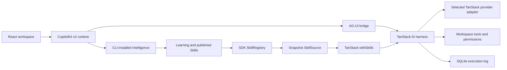

# Starter architecture

See [backend requirements and design](BACKEND-DESIGN.md) and [HTTP API contracts](API.md).
The source has explicit `src/client`, `src/server`, and browser-safe `src/shared` boundaries.
Hono composes feature routes and validation; CopilotKit’s Hono adapter owns its streaming protocol.

## Ownership

| Surface         | Owns                                                               | Entry                                                                  |
| --------------- | ------------------------------------------------------------------ | ---------------------------------------------------------------------- |
| CopilotKit v2   | Browser transcript, streaming, interrupts, tool renderers, history | `src/client/components/conversation.tsx`                               |
| TanStack Router | Shareable workspace, thread, selected file, inspector tab          | `src/client/router.tsx`                                                |
| TanStack Query  | Workspace management, file/Skill reads and invalidation            | `src/client/api.ts`                                                    |
| React           | Draft, theme, panel toggles, dialogs                               | `src/client/workspace.tsx`                                             |
| Runtime         | Local HTTP auth, user identity, Learning assignment                | `src/server/app.ts`                                                    |
| Harness         | Model loop, official coding plugins, permissions                   | `src/server/agent/harness.ts`                                          |
| Bridge          | Outer event IDs, terminal event, cancellation                      | `src/server/agent/bridge.ts`                                           |
| Skill plugin    | Per-turn verified snapshot and TanStack SkillSource                | `src/server/agent/learned-skills.ts`                                   |
| SQLite          | Local workspace registry and per-workspace private execution logs  | `src/server/workspaces/registry.ts`, `src/server/storage/log-store.ts` |

Intelligence owns durable product runs and Learning evidence. The SQLite execution log does not replace it. Keep `.data/` when restarting the app. New browser threads have distinct private proxy agents; register each before mounting its interrupt hooks.

The harness emits private message snapshots when it pauses. Their IDs differ from the outer conversation. The bridge omits those snapshots and retains streamed message/tool events, so Intelligence preserves one transcript across resume and replay. One outer start precedes all metadata; one terminal event closes the complete tool loop.

The Skill plugin adapts Intelligence to the portable loader in `@tanstack/ai-skills`. Intelligence owns published Skills and verifies archive checksums, paths, sizes, and manifests. TanStack `withSkills` adds the catalog and `load_skill`. `createResourceTool` adds `read_skill_resource`. This replaces the custom list/load/read tools. TanStack Intent remains separate development guidance.

The coding harness sets the SDK's `freshnessWindowMs` to zero. Before each turn, the plugin clears its previous snapshot and acquires a new snapshot. An unchanged response can reuse verified bytes. A rejected refresh or `registry.status.stale` leaves Skills unavailable for that turn. The model receives a limitation message and must not claim Skill use. The next turn attempts refresh again. The browser's independent Skill inspector retains its own SDK cache policy.

Each session holds its own snapshot reference. The catalog, raw `SKILL.md`, and supporting text all use that reference throughout the turn. Tool calls never fetch a separate revision. The adapter reads raw text through `readSkillFile`, because the SDK's `loadSkill` helper returns a JSON wrapper. Supporting text files can live at the skill root or in subfolders. TanStack rejects unsafe paths and checks the resource inventory before each read. Binary files remain unavailable, as in the previous integration.

Skill instructions do not grant workspace permissions. Existing tools still require approval for controlled actions, including after restart. TanStack lists instructions and resources but does not execute skill scripts. Its default catalog limit is approximately 4,000 tokens. An oversized catalog fails the run rather than silently omitting Skills. The SDK's `internal/learned-skills` export remains version-sensitive. Rerun the Skill and permission tests before a CopilotKit or TanStack upgrade.

## Workspace and transcript state

The workspace registry assigns each folder a stable ID and canonical path. Renaming changes only its label. Removing a workspace hides its entry; files, conversations, and execution logs remain. Opening the same folder again restores that ID. The default workspace preserves the original `coder` agent and execution log; other workspaces have separate agent IDs, runtime routes, and logs.

The browser stores workspace selection in the URL. Switching resets the selected thread and file; Query keys include workspace IDs. Intelligence remains the source of conversation history. The local registry stores no transcript.

TanStack Virtual renders measured transcript rows with stable text and tool-call IDs. `transcriptRows` derives text, individual exceptional calls, and consecutive completed activity groups from the SDK messages. Narrative, user messages, and pending approvals break groups; result messages do not create visual rows. CopilotKit still renders each tool through its registered renderer. A conversation-scoped disclosure map stores only explicit open/closed choices, so virtualization and group collapse do not discard those choices. Reload resets them. End anchoring follows streamed growth and appended messages while the reader is at the bottom. Scrolling up suspends following; the jump control returns to the latest message. CopilotKit still owns the messages; virtualization creates no second message store.

The session history also uses TanStack Virtual with stable thread IDs. Its visible range requests the next SDK page near the end, including when filtering leaves too few rows to fill the viewport. CopilotKit `useThreads` remains the owner of pagination and thread updates. Loading and errors stay in the list; a failed page pauses automatic fetching until Retry. Changing the search resets the list scroll position, while thread navigation preserves it. Focused session links stay mounted when scrolled out of view.

## Local trust boundary

The server binds to `127.0.0.1:4173`. It refuses foreign Host/Origin headers. Bootstrap returns an ephemeral bearer to the same-origin browser; authenticated APIs expose files, Skills, and the runtime. Provider and Intelligence keys stay server-side. Config responses use `no-store`.

Text previews reject dot paths, traversal, private/outside symlink targets, invalid UTF-8, binary files, and files above 256 KiB. `GET /api/workspace/asset` uses the same authentication and workspace registry, and returns at most 20 MiB of exact bytes with attachment, no-store, and nosniff headers. Both paths use a bounded read on an opened file descriptor; a file that grows during reading cannot bypass the cap. Browser asset requests carry the bearer in a header, never a URL. Discovery loads immediate directory children in pages of 100 entries. Server-side path search covers the whole public workspace without a total file or traversal cap. Git workspaces retain tracked files, unignored files, and deleted paths. Plain folders exclude dot paths, dependency trees, and symlinks. See [file discovery](FILE-DISCOVERY.md) for pagination, cancellation, refresh, and performance limits. The sample gets its own Git boundary so the starter's ignore rules cannot hide it.

This is a single-developer tool, not a hosted multi-user service. The shell tool can access the host after approval; it is not a sandbox. Use a trusted workspace. The fixed `local-developer` identity must be replaced before multi-user use.

## Build and extension points

Vite 8 uses Rolldown/Oxc for the browser. tsdown builds the Node entry and leaves Vite external because production does not load the dev server. Oxlint checks code; Oxfmt formats it; Vitest tests the backend; Playwright and axe test the browser. Direct dependencies and the package manager are pinned.

Configure coding models in `models.json`; extend adapters in `src/server/agent/models.ts`. See [model architecture](MODELS.md#code-level-design-and-extension). Add tools/plugins in `src/server/agent/harness.ts`. Render tool output with v2 `useDefaultRenderTool`/`useRenderToolCall`, or add a typed `useRenderTool` renderer. Use `useInterrupt` for permission decisions. Do not introduce a second chat client or message store.

The CopilotKit Inspector is explicitly enabled. The SDK shows it only on local development builds; production and remote hosts keep its built-in restrictions. The workspace's Files/Skills inspector is a separate app panel.

Temporary branch-image support is isolated in [TEMPORARY-INTELLIGENCE.md](TEMPORARY-INTELLIGENCE.md). Default app startup never patches or selects a backend image.

## Navigation, approvals, and motion

Saved session rows use TanStack Router links. The provider subscribes only to the workspace search value, so a thread selection does not change its configuration. The header owns the new-session action; there is no temporary list row whose removal would move saved sessions. Browser Back/Forward restores the selected link while saved row DOM nodes remain mounted. Transcript replay has its own local restoring state: the SDK also sets `isRunning` during replay, but that must not mark the workspace busy or dim other session links. File and Skill queries refresh only when an actual execution transitions back to idle, not when a conversation mounts or replays. Connecting/restoring text appears only after 250ms of pending work; fast restores show no transient label, and the load itself is never delayed.

`tool-approval.tsx` resolves the pending interrupt's tool-call ID against CopilotKit messages and reuses `ToolCall` for the proposed command, patch, or file contents. The decision applies to that interrupt only. A pending submission disables both actions; a rejected request restores them with an error. Approval state does not duplicate transcript state.

CSS uses short opacity/transform entrances for approvals, dialogs, and reopened panels, plus control feedback. Virtual transcript rows do not animate on remount. The jump control keeps a circular inner button in hover and focus states. The system reduced-motion setting disables animations and transitions.

## File viewer extension boundary

`src/client/viewers/registry.ts` owns lightweight extension dispatch. `Inspector` retains Router-provided selections and Query reads; `file-viewer.tsx` owns transient text controls. Add a format to the registry and implement its lazy renderer under `src/client/viewers/`; keep transport, parsing, and presentation separate. Preserve abort signals, workspace-scoped query keys, size limits, and local failure states. New archive formats require expansion limits and worker cancellation tests.

Code highlighting runs Shiki in a disposable worker with lazy grammar imports and a five-second deadline. Files with lines longer than 10,000 characters retain plain text. Source and spreadsheet rows are virtualized. PDF.js loads only for PDFs, renders one page at a time with a 16-million-pixel canvas cap, cancels page renders, and destroys documents on cleanup. Its extracted page text provides a selectable alternative to the canvas.

OOXML previews use fflate and fast-xml-parser in a worker. Parsing refuses document entities and external relationships, limits archive entries and expanded bytes, and terminates after ten seconds. React renders text and tables; embedded images use revocable blob URLs. No document HTML, macros, formulas, or remote assets execute. Supported reading previews are DOCX, XLSX and PPTX; legacy and unsupported formats expose downloads. Layout fidelity limits are shown in the viewer. Markdown excludes raw HTML, external images, and non-HTTP links. Asset queries have no retained cache after unmount.

Fixture tests accept `FILE_VIEWER_FIXTURE_URL` (default `http://127.0.0.1:4174`); browser app tests accept `FILE_VIEWER_APP_URL` (default `http://127.0.0.1:4173`). These are test overrides for isolated worktrees, not runtime configuration. The fixture uses a separate Vite cache to avoid development dependency-cache collisions with the app.

When running two development checkouts, set `PORT` for the second app and `STARTER_HMR_PORT` for its Vite reload WebSocket (for example, `PORT=4193 STARTER_HMR_PORT=24993 pnpm dev`). Without the override, Vite keeps its normal HMR default, 24678. This setting affects local development only.

## Goal execution

The native TanStack `goal` plugin owns objectives, judging, round limits, and
continuation state. `src/server/agent/goals.ts` adapts explicit composer commands to the native
session API. It streams the entire sequence of queued turns through one
Intelligence run, including plugin state snapshots. The ordinary prompt and
approval transport stays in place. The bridge preserves outer identities and
excludes private message snapshots. Stop removes queued work and cancels the
active native turn. CopilotKit replays the persisted state for the composer.
See [Goal design and limits](GOALS.md) for the lifecycle and verification contract.

## HTML and tree extensions

The text reader previews HTML directly in an iframe with `sandbox="allow-scripts"` and no same-origin grant. It does not parse or rewrite the document. Scripts run in the preview, but cannot access the parent document or its storage. Forms, popups, downloads, and top-level navigation remain sandboxed. Network requests remain possible; the preview does not serve relative workspace resources.

Workspace file responses add optional Git metadata from bounded, NUL-delimited porcelain reads. TanStack Query owns that data. Directory pages include aggregated folder status; search pages include matching file status. A pure tree model derives search ancestry. TanStack Virtual renders visible rows and retains the active row for keyboard access. React owns expansion and tree focus; Router still owns the selected file. See [the HTML and tree verification record](HTML-TREE-VERIFICATION.md) for the contract, constraints, and evidence.

## Approval settings and saved permissions

The authenticated local API exposes `/api/approval-mode` and `/api/permissions`. Both resolve workspace IDs through the registry and use the existing host, origin, and bearer checks.
Mode updates accept only the four native values. The browser cannot configure arbitrary plugins or submit permission rules for creation.
TanStack owns mode enforcement, approval resolution, and saved rules. CopilotKit v2 owns interrupts and the transcript. Query owns settings reads.
The server initializes only a new harness log to `acceptEdits`. Existing logs retain their native settings. Initialization runs before ordinary and Goal requests, even without the browser controls.
Native `setPluginSetting` persists changes in the log and applies them at the next turn. The active turn retains its settings snapshot.

SQLite now stores private harness metadata as well as execution logs. This is not an alternative transcript store.
The metadata adapter implements atomic compare-and-set with unique revisions. Native permissions use these revisions to save and remove workspace rules.
Removal calls `deleteSavedPermission` and `host.reload`. Reload discards native in-memory copies after active turns finish and before later turns start.
The removal response waits for this boundary. An error leaves the UI available for retry.

The preview plugin reads `PermissionResources` from the installed native coding plugins. It describes the exact rule pairs that native `always` saves.
The preview is descriptive only. Native permissions still inspect resources and enforce the submitted decision.
Its regression tests must accompany TanStack upgrades because native saved-rule derivation is version-sensitive.

### Separate planning behavior

The UI exposes permission preferences `acceptEdits` (Require permissions) and `bypass` (YOLO). Plan only is a separate behavior toggle.
The server applies native `plan` while the toggle is active. Metadata namespace `starter/permission-preference` retains the conversation preference.
Turning planning off restores that preference. Changing the preference during planning does not permit tools to change files.
The API accepts `{ permissions: "acceptEdits" | "bypass" }` or `{ planOnly: boolean }`. Per-conversation updates serialize.
The older `{ mode }` API remains compatible. Existing native default sessions retain their stricter policy until the user selects a preference.
Settings owns the saved-rule view. Closing Settings unmounts it, so reopening reads current rules.

## Workspace conversation defaults

`conversation-defaults.ts` owns the workspace's default model and permission preference in private metadata.
The settings HTTP routes expose validated reads and partial writes; Query owns confirmed browser values.
Permission initialization is the single entry point used by model reads, permission reads, and run startup.
It copies both defaults into an empty native log once, sharing concurrent initialization work.
Existing logs keep their native settings. The Goal judge continues to follow the thread model.
Appearance and custom swatches stay browser-local; System subscribes to operating-system theme changes.
