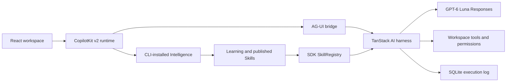

# Starter architecture

## Ownership

| Surface         | Owns                                                               | Entry                                   |
| --------------- | ------------------------------------------------------------------ | --------------------------------------- |
| CopilotKit v2   | Browser transcript, streaming, interrupts, tool renderers, history | `web/src/components/conversation.tsx`   |
| TanStack Router | Shareable workspace, thread, selected file, inspector tab          | `web/src/router.tsx`                    |
| TanStack Query  | Workspace management, file/Skill reads and invalidation            | `web/src/api.ts`                        |
| React           | Draft, theme, panel toggles, dialogs                               | `web/src/workspace.tsx`                 |
| Runtime         | Local HTTP auth, user identity, Learning assignment                | `src/app.ts`                            |
| Harness         | Model loop, official coding plugins, permissions                   | `src/harness.ts`                        |
| Bridge          | Outer event IDs, terminal event, cancellation                      | `src/bridge.ts`                         |
| Skill plugin    | Per-turn verified catalog and load/read tools                      | `src/learned-skills.ts`                 |
| SQLite          | Local workspace registry and per-workspace private execution logs  | `src/workspaces.ts`, `src/log-store.ts` |

Intelligence owns durable product runs and Learning evidence. The SQLite execution log does not replace it. Keep `.data/` when restarting the app. New browser threads have distinct private proxy agents; register each before mounting its interrupt hooks.

The harness emits private message snapshots when it pauses. Their IDs differ from the outer conversation. The bridge omits those snapshots and retains streamed message/tool events, so Intelligence preserves one transcript across resume and replay. One outer start precedes all metadata; one terminal event closes the complete tool loop.

The Skill plugin acquires a snapshot before each turn and injects `formatSkillCatalog`. Load/read tools use that same snapshot. A failed refresh clears the old catalog and tells the model not to claim Skill use. The SDK verifies downloaded archives. Its `internal/learned-skills` export is version-sensitive; rerun tests before a CopilotKit upgrade.

## Workspace and transcript state

The workspace registry assigns each folder a stable ID and canonical path. Renaming changes only its label. Removing a workspace hides its entry; files, conversations, and execution logs remain. Opening the same folder again restores that ID. The default workspace preserves the original `coder` agent and execution log; other workspaces have separate agent IDs, runtime routes, and logs.

The browser stores workspace selection in the URL. Switching resets the selected thread and file; Query keys include workspace IDs. Intelligence remains the source of conversation history. The local registry stores no transcript.

TanStack Virtual renders measured transcript rows with stable message IDs. End anchoring follows streamed growth and appended messages while the reader is at the bottom. Scrolling up suspends following; the jump control returns to the latest message. CopilotKit still owns the messages; virtualization creates no second message store.

The session history also uses TanStack Virtual with stable thread IDs. Its visible range requests the next SDK page near the end, including when filtering leaves too few rows to fill the viewport. CopilotKit `useThreads` remains the owner of pagination and thread updates. Loading and errors stay in the list; a failed page pauses automatic fetching until Retry. Changing the search resets the list scroll position, while thread navigation preserves it. Focused session links stay mounted when scrolled out of view.

## Local trust boundary

The server binds to `127.0.0.1:4173`. It refuses foreign Host/Origin headers. Bootstrap returns an ephemeral bearer to the same-origin browser; authenticated APIs expose files, Skills, and the runtime. Provider and Intelligence keys stay server-side. Config responses use `no-store`.

File previews reject dot paths, traversal, outside symlinks, binary files, and files above 256 KiB. Discovery uses Git's tracked/unignored files, capped at 1,000. Folders outside Git use a bounded walk of at most 10,000 entries, skip dot paths, dependency trees, and symlinks, and report truncated results. The sample gets its own Git boundary so the starter's ignore rules cannot hide it.

This is a single-developer tool, not a hosted multi-user service. The shell tool can access the host after approval; it is not a sandbox. Use a trusted workspace. The fixed `local-developer` identity must be replaced before multi-user use.

## Build and extension points

Vite 8 uses Rolldown/Oxc for the browser. tsdown builds the Node entry and leaves Vite external because production does not load the dev server. Oxlint checks code; Oxfmt formats it; Vitest tests the backend; Playwright and axe test the browser. Direct dependencies and the package manager are pinned.

Change `src/model.ts` for the coding model. Add tools/plugins in `src/harness.ts`. Render tool output with v2 `useDefaultRenderTool`/`useRenderToolCall`, or add a typed `useRenderTool` renderer. Use `useInterrupt` for permission decisions. Do not introduce a second chat client or message store.

The CopilotKit Inspector is explicitly enabled. The SDK shows it only on local development builds; production and remote hosts keep its built-in restrictions. The workspace's Files/Skills inspector is a separate app panel.

Temporary branch-image support is isolated in [TEMPORARY-INTELLIGENCE.md](TEMPORARY-INTELLIGENCE.md). Default app startup never patches or selects a backend image.

## Navigation, approvals, and motion

Saved session rows use TanStack Router links. The provider subscribes only to the workspace search value, so a thread selection does not change its configuration. The header owns the new-session action; there is no temporary list row whose removal would move saved sessions. Browser Back/Forward restores the selected link while saved row DOM nodes remain mounted. Transcript replay has its own local restoring state: the SDK also sets `isRunning` during replay, but that must not mark the workspace busy or dim other session links. File and Skill queries refresh only when an actual execution transitions back to idle, not when a conversation mounts or replays. Connecting/restoring text appears only after 250ms of pending work; fast restores show no transient label, and the load itself is never delayed.

`tool-approval.tsx` resolves the pending interrupt's tool-call ID against CopilotKit messages and reuses `ToolCall` for the proposed command, patch, or file contents. The decision applies to that interrupt only. A pending submission disables both actions; a rejected request restores them with an error. Approval state does not duplicate transcript state.

CSS uses short opacity/transform entrances for approvals, dialogs, and reopened panels, plus control feedback. Virtual transcript rows do not animate on remount. The jump control keeps a circular inner button in hover and focus states. The system reduced-motion setting disables animations and transitions.
